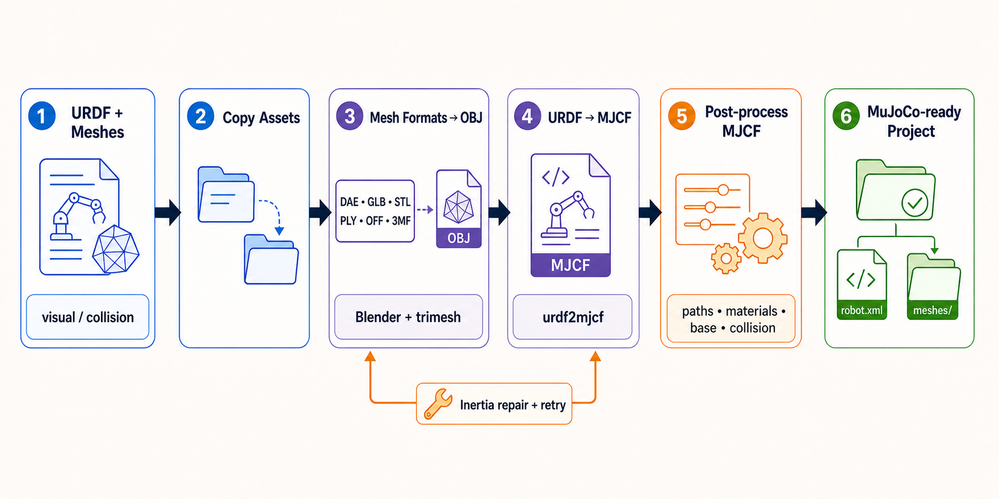

# URDF2MJCF Toolkit

[English](README.md) | [简体中文](README.zh-CN.md)

URDF2MJCF Toolkit is an automated Python toolchain for converting robot URDF models and their mesh assets into MuJoCo-ready MJCF projects.



## Description

A Python toolkit for converting URDF robot models and mesh assets into MuJoCo-ready MJCF projects.

## Features

- Converts URDF models to MJCF with a single pipeline command.
- Copies and normalizes visual and optional collision assets.
- Converts DAE and GLB meshes to OBJ for MuJoCo-friendly asset loading.
- Converts STL, PLY, OFF, and 3MF meshes to OBJ with `trimesh`.
- Generates OBJ-derived MJCF snippets with `obj2mjcf`.
- Repairs problematic inertia values by recalculating them from mesh geometry when conversion fails.
- Post-processes MJCF files to normalize mesh paths, textures, materials, default geom classes, ground plane, and fixed/floating base behavior.
- Includes helper tools for URDF inertia validation and MuJoCo model visualization.

## Requirements

- Python 3.11+ (the pinned `urdf2mjcf` dependency does not support Python 3.10)
- Blender with Collada support for DAE conversion; trimesh/pycollada provides an automatic fallback
- The default backend uses `obj2mjcf` and `urdf2mjcf` from the Python dependencies; `--backend mujoco` does not invoke either command
- Core dependencies include MuJoCo Python bindings for native conversion and final model validation

Install Python dependencies:

```bash
python -m pip install .
```

Install the optional MuJoCo viewer and development tools when needed:

```bash
python -m pip install '.[visualization]'
python -m pip install '.[dev]'
```

Install Blender on Ubuntu:

```bash
sudo apt install blender
blender --version
```

## Quick Start

Convert a URDF model with a fixed base:

```bash
python -m urdf2mjcf.urdf_to_mujoco_converter /path/to/robot.urdf
```

Specify an output directory and use a floating base:

```bash
python -m urdf2mjcf.urdf_to_mujoco_converter robot.urdf ./output --floating-base
```

Export collision meshes as separate MuJoCo collision geoms:

```bash
python -m urdf2mjcf.urdf_to_mujoco_converter robot.urdf ./output --export-collision
```

Enable debug logging:

```bash
python -m urdf2mjcf.urdf_to_mujoco_converter robot.urdf ./output --verbose
```

After installation, the shorter command is equivalent:

```bash
urdf2mjcf-toolkit robot.urdf ./output --verbose
```

## Conversion Backends

Select the conversion method with `--backend`:

| Backend | Behavior | Use case |
| --- | --- | --- |
| `urdf2mjcf` (default) | External URDF converter plus `obj2mjcf` material processing | Existing workflow and material splitting |
| `mujoco` | Native MuJoCo import without invoking `urdf2mjcf` or `obj2mjcf` | Direct conversion of URDF geometry instances, joints, and inertia |
| `auto` | Try the default backend, then native conversion if conversion, asset generation, or final validation fails | Automatically attempt an alternative conversion path |

```bash
urdf2mjcf-toolkit robot.urdf ./output --backend mujoco
urdf2mjcf-toolkit robot.urdf ./output --backend auto --floating-base
```

The native backend uses [MuJoCo's URDF importer](https://mujoco.readthedocs.io/en/3.8.0/modeling.html#urdf-extensions). It keeps the original model coordinates without lifting the robot and does not synthesize actuators or sensors. It uses URDF colors without splitting OBJ/MTL textures. Outputs can differ between backends; logs identify the selected backend, and Python callers can read `manager.last_backend`.

Both backends share mesh format conversion, base settings, ground setup, and final MuJoCo validation. Errors unrelated to inertia, such as missing executables, are reported or trigger backend fallback without recalculating inertia. Automatic recovery recalculates only invalid inertia definitions in a temporary URDF, preserving valid link masses, centers of mass, and tensors. Invalid definitions that lack usable geometry or a positive finite mass fail with a link-specific error.

Physical correctness checks and remaining limits are recorded in the [correctness audit](docs/correctness-audit.md). Conversion preserves explicit root/link inertias and joint dynamics; unsupported mimic, planar, and internal floating joints fail explicitly. Each run stages fresh assets and restores the previous XML and assets if conversion or publication fails. Output directories must be exclusive to one conversion task.

Inertia recalculation combines all geometries of the selected category, including mesh scales and frame rotations. It supports closed solid meshes and analytic box, sphere, and cylinder shapes, preserves existing mass, and assumes uniform density with additive component volumes. Any failed link aborts the source-file update.

## Checks and JSON Reports

Inspect a URDF before conversion:

```bash
urdf2mjcf-toolkit robot.urdf --check
urdf2mjcf-toolkit robot.urdf --check --report ./reports/check.json
urdf2mjcf-toolkit robot.urdf ./output --backend auto --report ./reports/conversion.json
```

`--check` validates XML, link/joint names, root links, parent/child references, cycles, mesh paths, and mesh scales. It also checks finite origins, nonzero joint axes, ordered joint limits, nonnegative dynamics/effort/velocity parameters, primitive dimensions, mass, and the principal moments of explicit inertia tensors. Both visual and collision declarations are checked. Problems are collected with joint/link and geometry-instance context. Both conversion backends enforce the same topology and physical input checks: the input must form one connected tree with unique names and exactly one parent and child declaration per joint.

Checks do not invoke converters or create the conversion output directory. Mesh contents, textures, inferred inertias, and compiled dynamics still require conversion and MuJoCo validation; a passing check does not guarantee a successful conversion. Velocity limits produce a `velocity_limit_unenforced` warning because they require controller enforcement. Warnings alone keep the check status `passed` and exit code `0`. Conversion-only options are ignored in check mode; the requested backend is recorded as context.

`--report` optionally saves JSON on success or failure. Conversion reports contain the requested/used backend, per-backend attempts and errors, failure stage, elapsed time, options, inertia recovery attempt count, and statistics from the validated model. Body counts exclude the world body; geometry counts include the generated floor. Check reports contain issues with codes and mesh references with resolved paths. Reports use `schema_version: 1`; check status is `passed`/`failed`, conversion status is `success`/`failed`. Exit code is `0` on success, `1` on a check, conversion, or report-writing failure (`2` for invalid CLI syntax). Report paths must end in `.json`; the input cannot be overwritten. Existing reports are replaced atomically.

Conversion reports also include `inertia_recoveries`: each entry identifies the backend, affected `links`, and recalculation status (`recalculated`, `unchanged`, or `failed`, with an error on failure). `recalculated` describes the temporary URDF repair; the overall conversion can still fail in a later stage.

`mesh_preprocessing` records supplemental conversions discovered through URDF references after conventional asset-directory processing. Each entry includes the original `source`, `format`, referencing `link`/`kind`/`reference` values, `status`, and output-relative `output` path. Failed conversions include `error`. `converted` means staging succeeded; check the overall report status before using the output. Sources already handled by directory processing are omitted from this list.

Successful conversion reports include an `assets` manifest. Each entry gives the output-relative `path`, `size_bytes`, SHA-256 checksum (`sha256`), and referencing MJCF assets (`references`, with `type`, `name`, and `attribute`). Entries describe the final model's file dependencies; procedural textures and unused intermediate files are not included. Batch results carry the same manifest for each successful model.

Python callers can inspect `manager.last_report` after `run()`, including after catching a conversion exception. This dictionary resets on each run. Read-only inspection is also available as `urdf2mjcf.inspection.inspect_urdf(path)`; neither API writes JSON automatically.

## Main CLI

```bash
python -m urdf2mjcf.urdf_to_mujoco_converter <urdf_path> [output_dir] [options]
```

Arguments:

- `<urdf_path>`: input URDF file.
- `[output_dir]`: optional output directory. If omitted, the converter creates a sibling `<input_parent>_mjcf` directory.

Options:

- `--backend {urdf2mjcf,mujoco,auto}`: select a conversion backend (default: `urdf2mjcf`).
- `--check`: check URDF structure, physical parameters, and mesh references without conversion.
- `--report PATH.json`: save a machine-readable check or conversion report.
- `--floating-base`: keep or insert a root `<freejoint>` for floating-base models. The default is fixed-base behavior.
- `--export-collision`: copy and process collision assets, then add collision geoms when the model does not already contain collision geometry.
- `--no-inertia-recalc`: disable automatic inertia recalculation when the initial URDF conversion fails.
- `-v, --verbose`: enable debug logging.

## Batch Conversion

```bash
urdf2mjcf-batch ./robots ./converted --backend auto --report ./reports/batch.json
urdf2mjcf-batch ./robots --check --report ./reports/checks.json
urdf2mjcf-batch ./robots ./converted --backend mujoco --fail-fast
```

The batch command recursively discovers `.urdf` files (case-insensitive extension) and processes them sequentially in sorted path order. Use `--no-recursive` to scan only the input directory. Each model has a separate output and asset tree: `robots/vendor/robot.urdf` becomes `converted/vendor/robot/robot.xml`. Models with the same filename in different folders remain independent. If the output root is omitted, it defaults to the sibling `<input_directory>_mjcf` folder.

By default, a failed model is recorded and processing continues. `--fail-fast` marks the remaining models as skipped after the first failure. Batch reports include each model's check/conversion report and `summary` counts (`total`, `succeeded`, `failed`, `skipped`). Aggregate status is `success` only when every model succeeds; otherwise it is `failed`. A missing/empty input directory or discovery failure also fails the batch. Exit codes are `0` for success, `1` for job/discovery/report errors, and `2` for invalid arguments.

The batch command supports the single-model backend, base, collision, inertia, check, report, and logging options. `--check` produces no conversion assets. Directory symlinks are not traversed, and the selected output subtree is excluded when it lies inside the input tree. Conversion rejects an output root equal to or containing the input directory, model output paths that escape the output root, and colliding/nested job outputs before creating conversion directories. For example, `a.urdf` and `a/b.urdf` would both write under `converted/a`; give these inputs distinct paths before converting them together. This output-layout restriction does not apply to check-only runs.

Batch planning also checks whether any job would replace another job's input URDF or referenced mesh, including references through symlinks. Such conflicts fail discovery before any model is converted; move the shared inputs outside the affected output trees. Existing shared assets elsewhere under the output root may still be used. An unreadable input symlink is recorded as a model failure, so unrelated jobs can continue unless `--fail-fast` is set.

Python usage:

```python
from urdf2mjcf.batch_conversion import BatchConversionManager

batch = BatchConversionManager("robots", "converted", backend="auto")
report = batch.run()
print(report["summary"])
```

`run()` returns the aggregate report, including model/discovery errors, and makes it available as `batch.last_report`. JSON is written only when requested through the CLI or `urdf2mjcf.reporting.write_report`.

## Helper Tools

Convert DAE files to OBJ with Blender:

```bash
python -m urdf2mjcf.dae_to_obj_converter ./meshes/visual ./converted_visual
```

Convert GLB files to OBJ and extract textures:

```bash
python -m urdf2mjcf.glb_to_obj_converter ./meshes/visual -o ./converted_visual
```

Convert STL, PLY, OFF, or 3MF files to OBJ:

```bash
mesh-to-obj ./meshes --overwrite
```

Generate MJCF snippets for OBJ asset folders:

```bash
python -m urdf2mjcf.obj_to_mjcf_converter ./output/meshes/visual --recursive
```

Recalculate URDF inertia values in place:

```bash
python -m urdf2mjcf.urdf_inertia_calculator robot.urdf --geometry visual
```

To repair only invalid inertia definitions while retaining valid calibrated values:

```bash
urdf-inertia robot.urdf --only-invalid --geometry collision
```

The standalone command updates the input in place and keeps a `.urdf.backup` when it makes changes. If all definitions are valid, `--only-invalid` writes nothing. Python callers can use `calculator.update_inertia(only_invalid=True)` and inspect `calculator.updated_links` after success. Omitting this flag retains explicit full recalculation of all eligible links.

Regularization tolerances and the optional minimum eigenvalue must be finite and nonnegative. Invalid parameters or numerical overflow abort the update before writing the URDF.

Validate URDF inertia values without modifying the file:

```bash
python kit/urdf_inertia_validator.py robot.urdf
```

Validate a generated MJCF model:

```bash
python kit/visualize_mujoco.py output/robot.xml --validate-only
```

Open the MuJoCo viewer:

```bash
python kit/visualize_mujoco.py output/robot.xml
```

## Conversion Workflow

1. Copy visual assets, and collision assets when requested.
2. Convert supported mesh formats in the staged asset directories to OBJ.
3. Resolve URDF visual/collision references and convert remaining DAE, GLB, PLY, OFF, and 3MF sources to OBJ.
4. Stage the URDF so mesh paths resolve correctly during backend conversion.
5. Convert URDF to MJCF with the selected backend, optionally retrying inertia errors after recalculation.
6. Run `obj2mjcf` over generated OBJ folders for the default backend; native conversion uses meshes directly.
7. Edit the final MJCF to normalize compiler paths, materials, textures, mesh variants, default geom classes, and base behavior.
8. Collect final MJCF file dependencies into the output asset tree and rewrite them as relative paths.
9. Compile the exact final XML with MuJoCo, then publish that XML and its assets together.

Supported layouts include `visual/`, `meshes/visual/`, and `urdf/robot.urdf` alongside `meshes/visual/`, with equivalent collision layouts. Mesh references may use relative paths, absolute paths, `file://`, or `package://` references resolvable in the local directory hierarchy. Converted OBJ files take precedence; ambiguous filenames produce an explicit error.

Referenced DAE, GLB, PLY, OFF, and 3MF files outside these layouts are also converted automatically, including explicit collision references without `--export-collision`. Repeated references to the same resolved source share one conversion per run, and `auto` reuses preprocessing when switching backends. Supplemental conversions use distinct generated names for different source paths, preserving same-named files from separate directories. Existing directory processing still rejects sources that compete for the same converted filename. OBJ/STL references retain direct import and final asset collection.

A required mesh conversion failure makes the main command exit with a nonzero status. Intermediate XML and staged URDF files are cleaned up automatically. Conversion, asset-copy, validation, or publication failures preserve the previous output XML and assets. Reruns refresh source meshes and skip subtrees already generated by `obj2mjcf`.

The output `meshes/` directory must not contain the input URDF or a referenced source mesh: conversion rejects that overlap to prevent publication from replacing input files. This also applies to input paths resolved through symlinks. Choose a separate output directory in that case.

DAE conversion falls back to trimesh/pycollada when Blender is unavailable or its Collada importer fails. Scene transforms are applied before meshes are merged.

## Output Layout

A typical output directory looks like this:

```text
output_dir/
  robot.xml
  meshes/
    visual/
      ... converted visual OBJ/XML/texture assets ...
      referenced/
        ... supplemental conversions, grouped by source ...
    collision/
      ... requested collision assets and supplemental collision conversions ...
    bundled/
      ... external runtime assets, named by SHA-256 and file extension ...
```

Copy the complete output directory to move a converted model. Final mesh and texture file references, including cube-map faces, are collected locally before validation; referenced collision meshes are included even without `--export-collision`. That option still controls collision-directory preprocessing and optional collision supplementation. Existing staged assets retain their layout. External files with identical bytes and extensions share a bundled copy, while different files with the same basename remain distinct. Source files are unchanged.

Collection covers files referenced by the final MJCF, including heightfields; it does not guarantee preservation of every source MTL/PBR feature or make unused intermediate XML snippets portable.

## Troubleshooting

- `Blender executable not found`: install Blender and confirm `blender --version` works, or pass `--blender-path` to the DAE converter.
- `obj2mjcf executable not found`: reinstall the package with `python -m pip install .` and confirm `obj2mjcf` is on `PATH`.
- Missing meshes or textures: check that the original URDF mesh paths point to existing visual/collision asset folders.
- Invalid inertia values: run `python kit/urdf_inertia_validator.py robot.urdf`, then retry conversion with inertia recalculation enabled.
- Model fails to load in MuJoCo: run `python kit/visualize_mujoco.py output/robot.xml --validate-only` for a focused validation pass.

## Development

The repository includes lightweight formatting and lint configuration in `pyproject.toml`.

CI covers Python 3.11, 3.12, and 3.13 and checks formatting and lint across the project. Tests include actual external conversions and MuJoCo model loading.

Recommended local checks:

```bash
python -m compileall urdf2mjcf kit
python -m pytest
ruff check .
black --check .
```

## Contributing

Contributions are welcome. Please open an issue or pull request with a clear description, reproduction steps for bugs, and example input models when possible.

## License

This project is licensed under the MIT License. See [LICENSE](LICENSE) for details.
