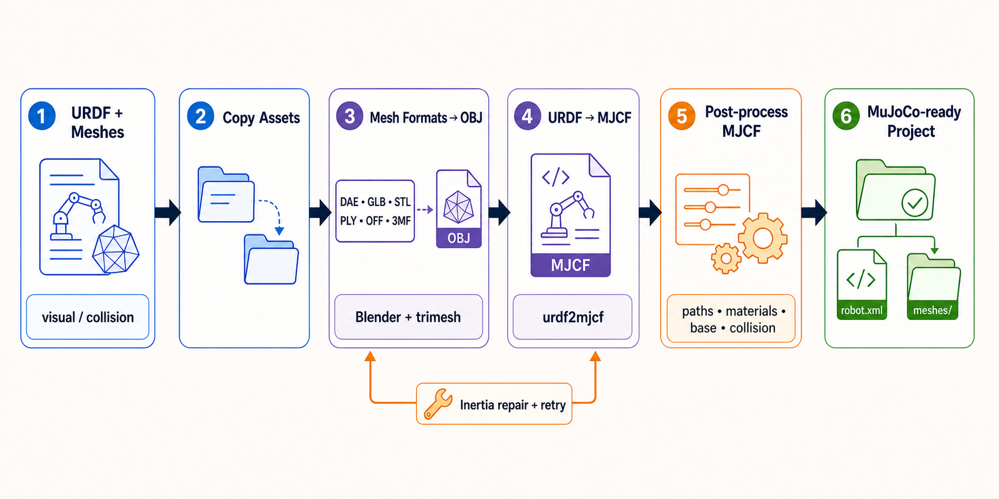

# URDF2MJCF Toolkit

[English](README.md) | [简体中文](README.zh-CN.md)

URDF2MJCF Toolkit 是一套自动化 Python 工具链，用于将机器人 URDF 模型及其网格资源转换为可供 MuJoCo 使用的 MJCF 项目。



## 功能特性

- 通过一条流水线命令将 URDF 转换为 MJCF。
- 复制并规范化视觉资源，可按需处理碰撞资源。
- 将 DAE、GLB、STL、PLY、OFF 和 3MF 网格转换为 MuJoCo 友好的 OBJ。
- 使用 `obj2mjcf` 为 OBJ 资源生成 MJCF 片段。
- 首次转换失败时，可根据网格几何自动重新计算异常惯量。
- 对最终 MJCF 进行后处理，包括网格路径、纹理、材质、默认 geom 类、地面和平动/固定基座设置。
- 提供 URDF 惯量校验和 MuJoCo 模型可视化辅助工具。

## 环境要求

- Python 3.11+（锁定的 `urdf2mjcf` 依赖不支持 Python 3.10）
- DAE 转换优先使用支持 Collada 的 Blender；不可用时自动使用 trimesh/pycollada
- 默认后端使用 Python 依赖提供的 `obj2mjcf` 和 `urdf2mjcf` 命令；`--backend mujoco` 无需调用这两个命令
- 核心依赖包含 MuJoCo Python 绑定，用于原生转换及最终模型校验

安装项目及核心依赖：

```bash
python -m pip install .
```

按需安装 MuJoCo 可视化和开发工具：

```bash
python -m pip install '.[visualization]'
python -m pip install '.[dev]'
```

在 Ubuntu 上安装 Blender：

```bash
sudo apt install blender
blender --version
```

## 快速开始

使用固定基座转换 URDF：

```bash
python -m urdf2mjcf.urdf_to_mujoco_converter /path/to/robot.urdf
```

指定输出目录并使用浮动基座：

```bash
python -m urdf2mjcf.urdf_to_mujoco_converter robot.urdf ./output --floating-base
```

将碰撞网格导出为独立的 MuJoCo 碰撞 geom：

```bash
python -m urdf2mjcf.urdf_to_mujoco_converter robot.urdf ./output --export-collision
```

开启调试日志：

```bash
python -m urdf2mjcf.urdf_to_mujoco_converter robot.urdf ./output --verbose
```

安装项目后也可使用简短命令：

```bash
urdf2mjcf-toolkit robot.urdf ./output --verbose
```

## 转换后端

通过 `--backend` 选择转换方式：

| 后端 | 行为 | 适用情况 |
| --- | --- | --- |
| `urdf2mjcf`（默认） | 使用外部 URDF 转换器，并通过 `obj2mjcf` 处理网格材质 | 保持现有流程，需要材质拆分 |
| `mujoco` | 使用 MuJoCo 原生导入器，跳过 `urdf2mjcf` 和 `obj2mjcf` 命令 | 需要直接保留 URDF 几何实例、关节和惯量 |
| `auto` | 先尝试默认后端，转换、资源生成或最终校验失败后尝试原生后端 | 希望自动尝试另一条转换路径 |

```bash
urdf2mjcf-toolkit robot.urdf ./output --backend mujoco
urdf2mjcf-toolkit robot.urdf ./output --backend auto --floating-base
```

原生后端使用 [MuJoCo 的 URDF 导入功能](https://mujoco.readthedocs.io/en/3.8.0/modeling.html#urdf-extensions)。它保留模型原始坐标，不自动抬升机器人，也不自动创建执行器和传感器；材质采用 URDF 颜色，不执行 OBJ/MTL 的纹理拆分。两种后端的输出可能不同，日志会显示实际使用的后端，Python 调用可读取 `manager.last_backend`。

各后端共用网格格式转换、固定/浮动基座设置、地面与最终 MuJoCo 校验。缺少外部命令等非惯量错误会直接报告或切换后端，不触发惯量重算。自动恢复仅在临时 URDF 中重算无效惯量，保留其他 link 的质量、质心和惯量张量。无效定义缺少可用几何或有限正质量时，会报错并指出对应 link。

具体数值验证和适用边界见[正确性检查记录](docs/correctness-audit.md)。转换保留显式定义的根节点/各 link 惯量和关节动力学参数；不支持的 mimic、planar、内部 floating 关节会明确失败。每次运行使用全新暂存资源，转换或发布失败时保留旧 XML 和旧网格。一个输出目录应由一个转换任务独占。

OBJ/STL 在不同目录中同名，或文件名与自动生成的缩放后缀相似时，各实例仍使用其确切源文件及缩放。碰撞几何与视觉共用源文件时，仍保留完整碰撞网格，视觉可按材质拆分。原生导入时使用的网格别名仅存在于临时目录，发布结果包含已收集的运行资源。

惯量重算会汇总选定类别的全部几何体，处理网格缩放和坐标系旋转；支持封闭实体网格及长方体、球、圆柱的解析计算。它保留已有质量，假设均匀密度且各组件体积可相加；任何 link 计算失败都不会写入部分更新。

## 转换前检查与 JSON 报告

```bash
urdf2mjcf-toolkit robot.urdf --check
urdf2mjcf-toolkit robot.urdf --check --report ./reports/check.json
urdf2mjcf-toolkit robot.urdf ./output --backend auto --report ./reports/conversion.json
```

`--check` 检查 XML、link/joint 名称、根节点、父子引用、关节环路、网格路径和缩放值，也检查有限的 origin、非零关节轴、有序限位、非负动力学/effort/velocity 参数、基本几何尺寸、质量及显式惯量张量的主惯量。视觉与碰撞定义均会检查；问题包含对应 joint、link 和几何实例的位置。两种转换后端使用相同的拓扑及物理参数检查：输入必须构成单棵连通树，名称唯一，且每个关节有且只有一个 parent 和 child 定义。

重复的单一定义（如多个惯量、axis、limit、origin 或 geometry）会报告 `ambiguous_definition`；独立惯量重算工具也不会改写这种输入。origin 须使用 `xyz`/`rpy`，目前会明确拒绝 `quat_xyzw`。有限非零关节轴会在导入前归一化，不受原数值大小影响。正 effort 上限约束关节的合计执行器力；effort 为零时保留被动自由度，并将所有自动生成执行器的输出力限制为零。

检查时不调用转换器，也不创建转换输出目录。网格内容、纹理、隐式推断的惯量和编译后的动力学仍需通过实际转换与 MuJoCo 校验；检查通过不代表转换一定成功。velocity 上限会产生 `velocity_limit_unenforced` 提示，说明速度约束需要控制器实现。只有 warning 时，检查状态仍为 `passed`，退出码为 `0`。检查模式忽略转换专用选项，仅将请求的后端记录为上下文。

`--report` 可在成功或失败时保存 JSON。转换报告包含请求与实际使用的后端、每次后端尝试及错误、失败阶段、耗时、转换选项、惯量恢复尝试次数，以及最终编译模型的统计信息。刚体数量不含 world，几何体数量包含自动添加的地面。检查报告包含带错误码的问题列表及网格引用的解析路径。报告使用 `schema_version: 1`；检查状态为 `passed`/`failed`，转换状态为 `success`/`failed`。成功退出码为 `0`，检查、转换或报告写入失败为 `1`，命令行语法错误为 `2`。报告路径须以 `.json` 结尾，不能覆盖输入文件；已有报告通过原子替换更新。

转换报告还包含 `inertia_recoveries`：每条记录提供后端、修改的 `links` 及重算状态（`recalculated`、`unchanged` 或 `failed`，失败时包含错误）。`recalculated` 仅表示临时 URDF 的惯量已修复，整体转换仍可能在后续阶段失败。

`mesh_preprocessing` 记录常规资源目录处理后，通过 URDF 引用发现的补充转换。每项包含原始 `source`、`format`、引用它的 `link`/`kind`/`reference`、`status`，以及相对输出目录的 `output` 路径；失败时包含 `error`。`converted` 表示暂存转换成功，使用输出前仍需检查整体报告状态。常规目录阶段已处理的源文件不列入该列表。

成功转换的报告还包含 `assets` 资源清单。每项提供相对输出目录的 `path`、`size_bytes`、SHA-256 校验值 `sha256`，以及引用它的 MJCF 资源 `references`（含 `type`、`name`、`attribute`）。清单记录最终模型的文件依赖，不包含程序生成的纹理及未使用的中间文件。批量报告中，每个成功模型也包含相同清单。

Python 调用可在 `run()` 后读取 `manager.last_report`，捕获转换异常后也可读取；每次运行都会重置报告。只读检查也可通过 `urdf2mjcf.inspection.inspect_urdf(path)` 调用。这两个 API 不会自动写入 JSON 文件。

## 主命令行接口

```bash
python -m urdf2mjcf.urdf_to_mujoco_converter <urdf_path> [output_dir] [options]
```

参数：

- `<urdf_path>`：输入 URDF 文件。
- `[output_dir]`：可选输出目录；省略时会创建与输入目录相邻的 `<input_parent>_mjcf` 目录。

选项：

- `--backend {urdf2mjcf,mujoco,auto}`：选择转换后端，默认 `urdf2mjcf`。
- `--check`：检查 URDF 结构、物理参数和网格引用，不执行转换。
- `--report PATH.json`：保存便于程序读取的检查或转换报告。
- `--floating-base`：保留或插入根节点 `<freejoint>`；默认使用固定基座。
- `--export-collision`：复制并处理碰撞资源；模型尚无碰撞几何时添加碰撞 geom。
- `--no-inertia-recalc`：出现惯量相关转换错误时不自动重新计算惯量。
- `-v, --verbose`：输出调试日志。

## 批量转换

```bash
urdf2mjcf-batch ./robots ./converted --backend auto --report ./reports/batch.json
urdf2mjcf-batch ./robots --check --report ./reports/checks.json
urdf2mjcf-batch ./robots ./converted --backend mujoco --fail-fast
```

批量命令默认递归扫描 `.urdf` 文件（扩展名不区分大小写），按路径排序后逐个处理。`--no-recursive` 只扫描输入目录的直接文件。每个模型使用独立的输出及资源目录，例如 `robots/vendor/robot.urdf` 输出到 `converted/vendor/robot/robot.xml`，不同目录中的同名模型不会互相覆盖。省略输出根目录时，默认为与输入目录相邻的 `<输入目录名>_mjcf`。

默认记录单个模型的失败后继续处理；`--fail-fast` 在首次失败后将剩余模型标为跳过。批量报告包含每个模型的检查或转换报告，以及 `summary` 中的总数、成功数、失败数和跳过数（`total`、`succeeded`、`failed`、`skipped`）。只有所有模型成功时，汇总状态才是 `success`，否则为 `failed`；输入目录为空、不存在或扫描失败也会使批次失败。全部成功退出码为 `0`，模型、扫描或报告写入失败为 `1`，参数错误为 `2`。

批量命令支持单模型命令的后端、基座、碰撞、惯量、检查、报告和日志选项。`--check` 不生成转换资源。扫描不会进入目录符号链接，也会排除位于输入目录内的指定输出子树。转换开始前会拒绝覆盖输入目录、输出越界，以及模型间重叠的输出路径。例如 `a.urdf` 与 `a/b.urdf` 都会写入 `converted/a` 下，需要先调整输入文件布局。只读检查不受这种输出布局限制。

批量规划还会检查各任务的发布是否覆盖其他任务的输入 URDF 或引用网格，包含通过符号链接引用的文件。这类冲突在任何模型转换前使发现阶段失败；应将共享输入移到受影响的输出树之外。输出根目录下未被任何任务替换的共享资源仍可使用。无法读取的输入符号链接会记录为单个模型失败，未启用 `--fail-fast` 时其他任务继续处理。

Python 调用：

```python
from urdf2mjcf.batch_conversion import BatchConversionManager

batch = BatchConversionManager("robots", "converted", backend="auto")
report = batch.run()
print(report["summary"])
```

`run()` 返回包含模型或扫描错误的汇总报告，也可通过 `batch.last_report` 读取；需要写入 JSON 时，可使用命令行 `--report` 或 `urdf2mjcf.reporting.write_report`。

## 辅助工具

使用 Blender 将 DAE 转换为 OBJ：

```bash
python -m urdf2mjcf.dae_to_obj_converter ./meshes/visual ./converted_visual
```

将 GLB 转换为 OBJ 并提取纹理：

```bash
python -m urdf2mjcf.glb_to_obj_converter ./meshes/visual -o ./converted_visual
```

将 STL、PLY、OFF 或 3MF 转换为 OBJ：

```bash
mesh-to-obj ./meshes --overwrite
```

为 OBJ 资源目录生成 MJCF 片段：

```bash
python -m urdf2mjcf.obj_to_mjcf_converter ./output/meshes/visual --recursive
```

直接更新 URDF 中的惯量：

```bash
python -m urdf2mjcf.urdf_inertia_calculator robot.urdf --geometry visual
```

仅修复无效惯量，保留其他已标定参数：

```bash
urdf-inertia robot.urdf --only-invalid --geometry collision
```

独立惯量命令会原地更新输入，并在发生修改时保留 `.urdf.backup`。所有定义有效时，`--only-invalid` 不写入任何文件。Python 可调用 `calculator.update_inertia(only_invalid=True)`，成功后通过 `calculator.updated_links` 查看修改对象。不加该选项时，仍会按明确请求重算所有符合条件的 link。

正则化容差及可选的最小特征值必须有限且非负。参数无效或计算溢出时，会在写入 URDF 前终止更新。

同一次惯量更新中，相同网格及有效缩放会复用其单位密度质量属性，各实例的坐标变换及各 link 的质量单独计算。计算属性后释放三角网格对象；更新结束即丢弃缓存，后续调用会读取修改后的源网格。

仅校验 URDF 惯量，不修改文件：

```bash
python kit/urdf_inertia_validator.py robot.urdf
```

校验生成的 MJCF：

```bash
python kit/visualize_mujoco.py output/robot.xml --validate-only
```

打开 MuJoCo 查看器：

```bash
python kit/visualize_mujoco.py output/robot.xml
```

## 转换流程

1. 复制视觉资源，并按需复制碰撞资源。
2. 将暂存资源目录中的受支持网格格式转换为 OBJ。
3. 解析 URDF 的视觉与碰撞引用，将尚未处理的 DAE、GLB、PLY、OFF、3MF 源文件转换为 OBJ。
4. 暂存 URDF，使后端转换期间能够正确解析网格路径。
5. 使用所选后端将 URDF 转换为 MJCF；遇到惯量错误时可更新惯量后重试。
6. 默认后端对生成的 OBJ 目录运行 `obj2mjcf`；原生后端直接使用网格。
7. 编辑最终 MJCF，规范化编译器路径、材质、纹理、网格变体、默认 geom 类和基座行为。
8. 将最终 MJCF 的文件依赖收集到输出资源目录，并改写为相对路径。
9. 使用 MuJoCo 编译即将发布的 XML，通过后一起发布该 XML 和资源。

支持 `visual/`、`meshes/visual/`，以及 `urdf/robot.urdf` 配合相邻 `meshes/visual/` 的目录布局；碰撞目录同理。网格引用支持相对路径、绝对路径、`file://` 和能在本地目录层级找到的 `package://` 路径。优先使用转换后的 OBJ，无法确定唯一文件时明确报错。

这些目录之外，被 URDF 引用的 DAE、GLB、PLY、OFF、3MF 也会自动转换；显式碰撞引用无需启用 `--export-collision`。每次运行中，指向同一实际源文件的引用共用一次转换，`auto` 切换后端时也会复用预处理结果。补充转换按不同源路径分配独立名称，分别保存不同目录中的同名文件；常规目录处理仍会拒绝争用同一转换文件名的源文件。OBJ/STL 引用继续采用直接导入与最终资源收集。

任何必需的网格转换失败都会使主命令返回非零状态。中间 XML 和暂存 URDF 会自动清理；转换、资源复制、校验或发布失败时，保留已有输出 XML 和资源。重复运行会重新转换源网格，并跳过 `obj2mjcf` 已生成的资源子树。

输出的 `meshes/` 目录不能包含输入 URDF 或被引用的源网格，转换会拒绝这种重叠，避免发布时替换输入文件；通过符号链接解析到这些位置的输入也会被保护。遇到此情况，应选择独立的输出目录。

Blender 不可用或其 Collada 导入器转换失败时，DAE 转换自动回退到 trimesh/pycollada，并在合并网格前应用场景节点变换。

GLB 转换会合并材质兼容的实例，在同一 OBJ 中保留不同材质的分组；`--no-merge` 保留所有几何分组。具名材质、纯色及各材质的基础颜色纹理分别绑定，提取图像时生成本地文件名，不将图像显示名用作路径。MJCF 中的显式颜色与纹理绑定优先于按文件名猜测的纹理。此流程未复现完整的 glTF PBR 着色模型。

缺失的绝对网格路径、`file://` 路径及父目录引用会明确失败；普通相对引用仍保留按文件名兼容查找的行为。

## 输出结构

典型输出目录如下：

```text
output_dir/
  robot.xml
  meshes/
    visual/
      ... 转换后的视觉 OBJ/XML/纹理资源 ...
      referenced/
        ... 按源文件分组的补充转换资源 ...
    collision/
      ... 按选项生成的碰撞资源及补充碰撞转换 ...
    bundled/
      ... 以 SHA-256 和扩展名命名的外部运行资源 ...
```

迁移模型时复制整个输出目录即可。最终网格和纹理文件引用（含立方体纹理的各个面）会在校验前收集到本地；即使不传 `--export-collision`，最终模型已引用的碰撞网格也会收集。该选项仍控制碰撞目录的预处理与可选碰撞补全。已暂存的资源保留布局；内容及扩展名相同的外部文件共用一份副本，同名但内容不同的文件分别保存。源文件不会被修改。

资源收集覆盖最终 MJCF 引用的文件，也支持高度场；它不保证保留源 MTL/PBR 的全部表现，也不保证未使用的中间 XML 片段可单独迁移。

## 常见问题

- `Blender executable not found`：安装 Blender 并确认 `blender --version` 可执行，或向 DAE 转换器传入 `--blender-path`。
- `obj2mjcf executable not found`：执行 `python -m pip install .` 重新安装项目，并确认 `obj2mjcf` 在 `PATH` 中。
- 网格或纹理丢失：检查原 URDF 中的网格路径是否指向已有的视觉/碰撞资源目录。
- 惯量无效：运行 `python kit/urdf_inertia_validator.py robot.urdf`，然后在启用自动惯量重算的情况下重试。
- MuJoCo 无法加载模型：运行 `python kit/visualize_mujoco.py output/robot.xml --validate-only` 获取针对性的校验结果。

## 开发

CI 覆盖 Python 3.11、3.12 和 3.13，并检查整个项目的格式与静态分析。测试包括实际调用转换器及 MuJoCo 加载校验。

推荐的本地检查：

```bash
python -m compileall urdf2mjcf kit
python -m pytest
ruff check .
black --check .
```

## 参与贡献

欢迎提交 Issue 或 Pull Request。报告问题时请包含清晰的说明、复现步骤，并尽可能提供示例输入模型。

## 许可证

本项目采用 MIT 许可证，详见 [LICENSE](LICENSE)。
